# CampusUNSA Product Roadmap

This document outlines the strategic engineering roadmap for CampusUNSA, aligned with the [Agile Sprint Plan](docs/planning/agile-sprint-plan.md) and the [Software Requirements Specification](docs/requirements/software-requirements-specification.md).

---

## Current Status: Milestone v0.3.0 (Sprint 3 Completed)

```mermaid
flowchart LR
    S1["Sprint 1: Foundation"] --> S2["Sprint 2: Auth & RBAC"]
    S2 --> S3["Sprint 3: Academic Sync & Perf"]
    S3 --> S4["Sprint 4: Task Board & Offline"]
    S4 --> S5["Sprint 5: WhatsApp Gateway"]
    S5 --> S6["Sprint 6: NLP Task Extraction"]
    S6 --> S7["Sprint 7: Secretarial Guidance"]
    S7 --> S8["Sprint 8: RAG & Extensions"]
    S8 --> S9["Sprint 9: Pilot & Release v1.0"]

    style S1 fill:#dcfce7,stroke:#16a34a,stroke-width:2px
    style S2 fill:#dcfce7,stroke:#16a34a,stroke-width:2px
    style S3 fill:#dcfce7,stroke:#16a34a,stroke-width:2px
    style S4 fill:#dbeafe,stroke:#2563eb,stroke-width:2px
    style S5 fill:#f1f5f9,stroke:#64748b,stroke-width:1px
    style S6 fill:#f1f5f9,stroke:#64748b,stroke-width:1px
    style S7 fill:#f1f5f9,stroke:#64748b,stroke-width:1px
    style S8 fill:#f1f5f9,stroke:#64748b,stroke-width:1px
    style S9 fill:#f1f5f9,stroke:#64748b,stroke-width:1px
```

---

## 1. Core Development Phases (v1.0.0 Release Target)

### Phase 1: Foundation & Identity (Sprints 1-2) - Completed
- [x] **US-01:** Fully reproducible Docker Compose environment (FastAPI, Next.js, Postgres, Redis, Evolution API).
- [x] **US-02:** Institutional Google OAuth login restricted to `@unsa.edu.pe` domains (HTTP 403 rejection for external domains).
- [x] **US-03:** Role-Based Access Control (RBAC) security dependencies with 100% test coverage.

### Phase 2: Academic Hub & Continuous Concurrency (Sprints 3-4) - In Progress
- [x] **US-04:** Google Classroom course and assignment synchronization engine.
- [x] **TECH-02 (CR-01):** Continuous 1,000-user load verification gate and ASGI request capacity middleware.
- [x] **US-10:** Structured NLP academic task extraction with Gemini/Ollama and deterministic fallback.
- [ ] **US-05:** Visual Academic Task Board with urgency traffic lights and Kanban state tracking.
- [ ] **US-06:** Dynamic weekly class schedule and next class indicator widget.
- [ ] **US-07:** Progressive Web Application (PWA) service worker caching with 100% offline navigation.

### Phase 3: Conversational Messaging & Natural Language (Sprints 5-6) - Upcoming
- [ ] **US-08:** Secure 5-minute OTP phone pairing lifecycle via WhatsApp and Redis.
- [ ] **US-09:** Evolution API inbound webhook ingestion gateway with idempotency verification.
- [ ] **US-11:** Automated task scheduling and creation with conversational WhatsApp confirmation.

### Phase 4: Guidance Desk & Secretarial Escalation (Sprint 7) - Planned
- [ ] **US-12:** Interactive university procedures and bureaucracy flowcharts.
- [ ] **US-13:** Human secretarial escalation and ticket management console with role protection.

### Phase 5: Hardening, Knowledge Base & Release v1.0 (Sprints 8-9) - Planned
- [ ] **US-14:** Official university regulations knowledge base and RAG query engine.
- [ ] **US-15:** Multi-service end-to-end stress verification.
- [ ] **US-16:** System hardening, live pilot with 30 active engineering students, and v1.0 release milestone.

---

## 2. Post-v1.0 Candidate Initiatives (Future Horizon)

These candidate features are evaluated in the Agile Sprint Plan for deployment in post-v1.0 release cycles:

1. **Campus GIS Navigation & Classroom Locator (`Candidate`):**
   - Interactive high-resolution campus map covering Ingenierias, Biomedicas, and Sociales campuses with route pathfinding.
2. **Community Lost & Found Hub (`Candidate`):**
   - Verified student claim lifecycle for misplaced academic belongings within university premises.
3. **Study Session Pomodoro Timer & iCal Export (`Candidate`):**
   - Focused study tracker integrated with academic task deadlines and calendar synchronization.
4. **Dining Hall Occupancy Geofencing & SISUNSA Integration (`Future`):**
   - Real-time queue telemetry and automated lunch ticket quota verification.
5. **Digital Student ID Barcode & Turnstile Access (`Future`):**
   - Offline-capable cryptographic student ID barcode for automated campus turnstile entry.
