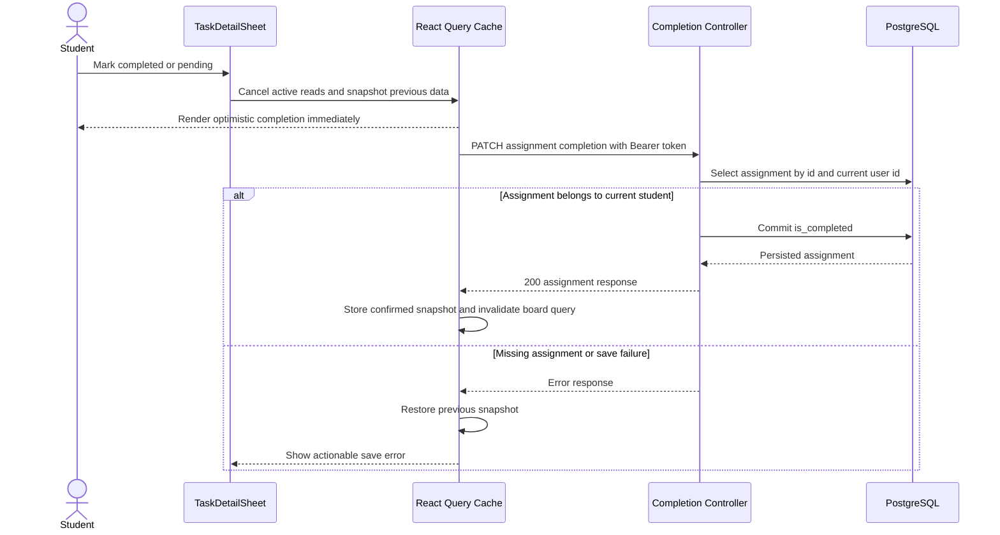

# Academic Task Board Architecture

## Table of Contents

- [Overview and Scope](#overview-and-scope)
- [Layered Anatomy](#layered-anatomy)
- [Urgency Contract](#urgency-contract)
- [Completion Request Lifecycle](#completion-request-lifecycle)
- [Schemas and Storage](#schemas-and-storage)
- [Presentation and Accessibility](#presentation-and-accessibility)
- [Verification Runbook](#verification-runbook)
- [Operational Boundaries](#operational-boundaries)

## Overview and Scope

US-05 implements SRS REQ-09: students prioritize academic assignments using deadline groups and a single urgency indicator per assignment. The existing `Hoy` screen remains the task board, while `Calendario` reads the same cached assignment collection. Both screens open `TaskDetailSheet` to manage completion. This story does not introduce another navigation tab, replace Google authentication, implement WhatsApp pairing, or deliver the separate US-07 service worker story.

Completion describes the student's progress inside CampusUNSA. It does not represent a verified submission to Moodle or Google Classroom. The source publication state remains unchanged, and imported assignments retain completion when synchronization updates their titles, dates, and descriptions.

## Layered Anatomy

| Layer | Implementation | Responsibility |
| :--- | :--- | :--- |
| Presentation | `frontend/src/components/HoyView.tsx` | Group deadlines, filter sources, render mandatory view states |
| Detail | `frontend/src/components/TaskDetailSheet.tsx` | Complete or reopen an assignment through a dedicated sheet |
| Date service | `frontend/src/lib/task-urgency.ts` | Pure urgency classification and stable deadline ordering |
| Query service | `frontend/src/hooks/useAcademicBoard.ts` | Read data, optimistic mutation, rollback, invalidation, cache persistence |
| Controller | `backend/app/api/v1/classroom.py` | Authenticate and update an assignment owned by the current user |
| Storage | `backend/app/models/classroom.py` | Persist the independent `is_completed` boolean |

TanStack Query v5 coordinates server state. Query keys include the current session, and persisted snapshots use the JWT subject to keep students' academic data separate. Parsing that subject on the client only selects a local cache; the backend still validates every authenticated request. Anonymous views do not fetch academic endpoints or hydrate another student's snapshot.

## Urgency Contract

The classifier compares absolute instants in milliseconds, preserving explicit UTC offsets. It never rounds elapsed hours before checking a boundary.

| Remaining time | Group | Indicator |
| :--- | :--- | :--- |
| Negative | Overdue | Neutral, with an explicit overdue label |
| Zero through less than 24 hours | Urgent | Red |
| Exactly 24 through exactly 72 hours | Soon | Yellow |
| More than 72 hours | Later | Green |
| Missing or invalid deadline | Undated | Neutral |
| Completed assignment | Completed | Neutral completion indicator |

Within each group, assignments are ordered by deadline. A 30-second timer updates urgency while the board remains open. Unit tests freeze UTC clocks and cover millisecond boundaries, equivalent timezone offsets, missing dates, elapsed time, ordering, and immutable inputs.

## Completion Request Lifecycle



The completion action is disabled while its mutation is pending, preventing repeated toggles from racing. Mutation callbacks carry the originating session token so a late response cannot update a different student's cache. A failed refresh leaves existing data visible. Offline users can inspect saved tasks; completion changes require connectivity and are not silently queued.

## Schemas and Storage

| Contract | Fields and behavior |
| :--- | :--- |
| `PATCH /api/v1/classroom/assignments/{assignment_id}/completion` | UUID path parameter and authenticated ownership check |
| `AssignmentCompletionRequest` | Required strict boolean `is_completed`; extra fields rejected |
| `AssignmentResponse` | Existing assignment fields plus `is_completed` |
| `DuticAssignmentResponse` | Exposes the same completion flag for Moodle assignments |
| `classroom_assignments.is_completed` | Non-null boolean, Python and database defaults are false |

The endpoint accepts assignments from either LMS origin because both use the same owner-scoped storage model. It returns `404 ASSIGNMENT_NOT_FOUND` for unknown or foreign assignments, avoiding cross-student data disclosure. Setting an already-completed assignment to completed is idempotent. Migration `d5e6f7a8b9c0` backfills existing assignments as pending and has a reversible downgrade. Alembic continues to isolate external Evolution API tables through the existing `include_object` filter.

## Presentation and Accessibility

The user story explicitly requires red, yellow, and green urgency indicators. Yellow and green therefore extend the existing semantic token palette as `deadline-soon` and `deadline-later`, each with a dark variant. This story uses one compact badge per row, with a colored dot and readable neutral text. Source attribution remains secondary text rather than an additional colored badge. Deadline color is never the sole means of identifying priority.

Konsta inset lists, the three existing tabs, system fonts, and the shared detail sheet remain in use. Rows are single keyboard-accessible button targets with chevrons; completion controls live in the sheet. Headlines clamp to two lines, metadata truncates, and interactive controls have a minimum 44-pixel target. Light and dark modes are verified at 360 and 768 pixels. Spanish product copy is centralized in `task-board-messages.ts`.

## Verification Runbook

```bash
docker compose exec backend alembic upgrade head
docker compose exec backend alembic check
docker compose exec backend python -m pytest tests/ -q --cov=app --cov-branch --cov-fail-under=80
docker compose exec backend ruff check app tests
docker compose exec frontend npm run test
docker compose exec frontend npx tsc --noEmit
node scripts/verify-ui-directives.mjs
```

Browser checks use mocked academic API responses and a fixed UTC clock, independently of Google services:

```bash
cd frontend
npx playwright install chromium
npm run test:e2e
```

On Windows, `PLAYWRIGHT_CHROMIUM_EXECUTABLE_PATH` can select an installed Edge or Chrome executable. CI installs Playwright's matching Chromium version. The browser suite checks actual computed indicator colors, horizontal overflow, optimistic feedback, persistence after reload, and rollback after a failed save in all four viewport/theme combinations. Its screenshots and traces are retained as CI artifacts. Backend tests independently verify database persistence and authorization against an isolated database.

## Operational Boundaries

> [!NOTE]
> Apply the migration before starting the updated application against an existing database. Marking an assignment completed does not upload files or change the LMS submission state.

The load scenario registry includes the completion endpoint. A dedicated synthetic completion identity prevents destructive cleanup scenarios from deleting the assignment used to measure writes. Authentication, WhatsApp pairing, and unrelated settings actions remain outside US-05.

The cache mutation flow follows the [TanStack Query optimistic update guidance](https://tanstack.com/query/v5/docs/framework/react/guides/optimistic-updates). Concrete validation results and screenshots are recorded in `docs/testing/us05-task-board.md`.
