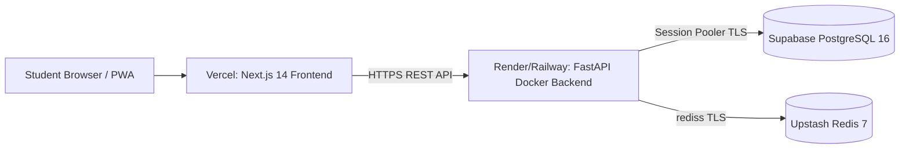
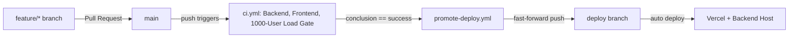

# Cloud Deployment Guide: Vercel + Render + Supabase + Upstash

This guide defines the recommended split-stack cloud deployment topology for CampusUNSA using free-tier managed services and a CI-gated `deploy` branch.

---

## 1. Architecture Overview

CampusUNSA splits its runtime across specialized platforms:

- **Vercel (Hobby Free Tier):** Hosts `frontend/` (Next.js 14 PWA).
- **Render (Free Web Service) or Railway:** Hosts `backend/` (FastAPI Docker service + Alembic migrations).
- **Supabase (Free Tier):** Hosts PostgreSQL 16 (via IPv4 Session Pooler on port `5432` with SSL).
- **Upstash (Free Tier):** Hosts Redis 7 over TLS (`rediss://`) for OTP state and `/api/v1/health`.



### CI-Gated Promotion Flow

Production deployments follow a protected branch model so unverified commits never trigger Vercel or backend builds:



---

## 2. Step-by-Step Infrastructure Setup

### Step 1: Provision PostgreSQL on Supabase (Free Tier)

1. Create a Supabase project in your target region (for example `us-east-1`, aligned with Render and Vercel US East).
2. Open **Connect -> Connection String** and choose **Session pooler** (port `5432`, IPv4 compatible).
3. Record the connection URI and append `?sslmode=require`:
   ```text
   postgresql://postgres.<PROJECT_REF>:<DB_PASSWORD>@aws-0-us-east-1.pooler.supabase.com:5432/postgres?sslmode=require
   ```
4. Note that `backend/alembic/env.py` configures `include_object` so Alembic manages only CampusUNSA metadata tables and never alters Supabase internal tables.

### Step 2: Provision Redis on Upstash (Free Tier)

1. Create a Regional Redis database in Upstash (`us-east-1`, Free plan).
2. Copy the TLS connection string (`REDIS_URL`), formatted as:
   ```text
   rediss://default:<UPSTASH_PASSWORD>@<HOST>.upstash.io:6379
   ```

### Step 3: Generate Distinct Production Secrets

Run locally to generate two separate 256-bit hex secrets (`Settings.validate_and_resolve_urls` enforces `ENCRYPTION_KEY != SECRET_KEY` in `production`):

```bash
openssl rand -hex 32   # SECRET_KEY
openssl rand -hex 32   # ENCRYPTION_KEY
```

### Step 4: Deploy Backend (`backend/`) on Render (Free Tier)

1. In Render, select **New -> Web Service** and connect `MarcoXMarquez/CampusUNSA`.
2. Configure:
   - **Branch:** `deploy`
   - **Root Directory:** `backend`
   - **Runtime:** `Docker`
   - **Docker Command (overrides dev `--reload`):**
     ```bash
     sh -c "alembic upgrade head && uvicorn app.main:app --host 0.0.0.0 --port ${PORT:-8000}"
     ```
3. Configure Environment Variables:

| Variable | Value |
| :--- | :--- |
| `ENVIRONMENT` | `production` |
| `DEBUG` | `False` |
| `SECRET_KEY` | Generated 64-char hex secret #1 |
| `ENCRYPTION_KEY` | Generated 64-char hex secret #2 (distinct) |
| `DATABASE_URL` | Supabase Session Pooler URI with `?sslmode=require` |
| `REDIS_URL` | Upstash `rediss://...` URI |
| `BACKEND_CORS_ORIGINS` | `["https://<your-app>.vercel.app"]` |
| `GOOGLE_CLIENT_ID` | Google Cloud OAuth Client ID |
| `GOOGLE_CLIENT_SECRET` | Google Cloud OAuth Client Secret |
| `GOOGLE_REDIRECT_URI` | `https://<your-backend>.onrender.com/api/v1/auth/google/callback` |
| `TASK_PARSER_PROVIDER` | `disabled` (or `gemini` with `GEMINI_API_KEY`) |

4. After deployment succeeds, verify `https://<your-backend>.onrender.com/api/v1/health` returns HTTP 200 with `"status": "healthy"`.

### Step 5: Deploy Frontend (`frontend/`) on Vercel

1. In Vercel, import `MarcoXMarquez/CampusUNSA`.
2. Set **Root Directory** to `frontend` and Framework Preset to `Next.js`.
3. Add Environment Variables:

| Variable | Value |
| :--- | :--- |
| `NEXT_PUBLIC_API_URL` | `https://<your-backend>.onrender.com/api/v1` |
| `NEXT_PUBLIC_GOOGLE_CLIENT_ID` | Same Google Cloud OAuth Client ID |

4. Deploy once to obtain your `.vercel.app` domain, then update `BACKEND_CORS_ORIGINS` in Render with that exact HTTPS origin (no trailing slash).
5. Under **Vercel Project Settings -> Git -> Production Branch**, set `deploy` instead of `main`.

### Step 6: Protect the `deploy` Branch on GitHub

1. Create or let `promote-deploy.yml` initialize the `deploy` branch once `ci.yml` passes on `main`.
2. In **GitHub -> Settings -> Branches / Rulesets**, restrict direct pushes to `deploy` by human developers while allowing GitHub Actions (`promote-deploy.yml`) to fast-forward verified commits.

### Step 7: Update Google Cloud OAuth Console

1. Add `https://<your-app>.vercel.app` under **Authorized JavaScript origins**.
2. Add `https://<your-backend>.onrender.com/api/v1/auth/google/callback` under **Authorized redirect URIs**.
