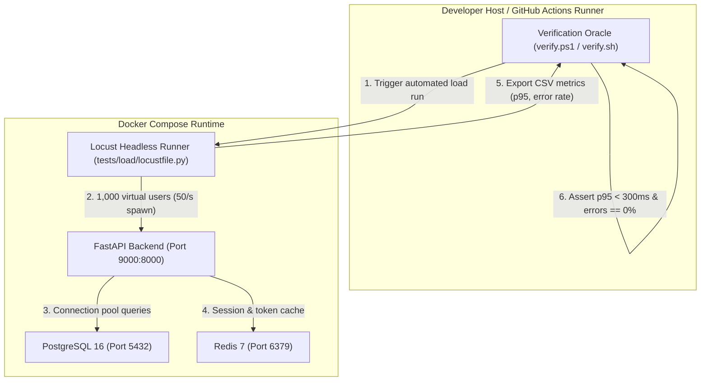

# CampusUNSA: Agile Change Request Specification (CR-01)

## Document Identifier: CR-CAMPUSUNSA-2026-01
### Change Classification: Scope Evolution & Continuous Performance Engineering
### Reference Baseline: SRS v1.0 (REQ-39, NFR-01) & Agile Sprint Plan v1.0 (US-15)
### Date of Submission: October 17, 2026
### Target Ingestion Iteration: Sprint 3 (Kickoff: October 21, 2026)

---

## 1. Stakeholder Request & Problem Statement

### 1.1 Origin of Request
* **Stakeholder / Academic Directive:** Academic Advisory Board / Course Directorate.
* **Directive Summary:** The engineering team must validate and guarantee system resilience under a concurrent load of 1,000 active university users on an iterative basis across every development sprint, rather than deferring stress verification to an isolated milestone at the end of the project lifecycle.

### 1.2 Business and Architectural Rationale
Deferring load testing until Sprint 8 (as originally scheduled in `US-15`) introduces critical architectural risk:
1. **Late Bottleneck Discovery:** Database connection pool exhaustion, N+1 ORM query patterns, or unindexed foreign keys discovered in Sprint 8 would require fundamental architectural refactoring immediately prior to release.
2. **Institutional Peak Traffic:** Course registration and assignment deadline windows at UNSA generate simultaneous spikes exceeding 1,000 concurrent students across the Ingenierias, Biomedicas, and Sociales campuses.
3. **Shift-Left Quality Assurance:** Validating performance increments continuously enables early detection of latency regressions introduced by new endpoints or database schemas.

---

## 2. Agile Change Management & Capacity Reallocation

### 2.1 The Scrum Zero-Sum Principle & Capacity Impact
In accordance with Scrum principles, the active sprint (Sprint 2) is inviolable and its sprint goal remains protected. The change is formally processed during backlog refinement and staged for ingestion in **Sprint 3**.

* **Team Velocity Impact:** Constructing the automated load testing harness represents an estimated effort of **5 Story Points**. Maintaining and executing incremental load scenarios across subsequent sprints consumes approximately **2 Story Points** per sprint.
* **Backlog Adjustment:** 
  * Sprint 3 originally contained single-story allocation (`US-04: Google Classroom Sync Engine` - Lead: `@MarcoXMarquez`).
  * Sprint 3 possesses sufficient uncommitted capacity to absorb the Enabler Story without displacing functional user stories.
  * Originally planned candidate story `US-15` (scheduled for Sprint 8) is formally decoupled: its infrastructure enabler is brought forward to Sprint 3, while Sprint 8 retains full end-to-end multi-service stress verification.

### 2.2 Workload Allocation & Team Matrix Alignment

| Role | Engineer | GitHub Handle | Responsibility |
| :--- | :--- | :--- | :--- |
| **Lead Developer** | Alejandro Sebastian Alfonso Huacasi | `@Sebastianzzzin` | Docker Compose Locust service, Locust load scripts, dataset synthesis |
| **Peer Reviewer / QA** | Ricardo Mauricio Chambilla Perca | `@rikich3` | Verification oracle hooks, CI workflow integration, metrics threshold auditing |
| **Product Owner Sign-off** | Marco Antonio Marquez Herrera | `@MarcoXMarquez` | Backlog prioritization, capacity balancing, SRS alignment |

---

## 3. Product Backlog Item Specification (PBI: TECH-02 / ENABLER-01)

### 3.1 Item Identification
* **PBI Code:** `TECH-02` (Accelerated Component of `US-15`)
* **Title:** Continuous Automated Load Testing Harness & Concurrency Gate (1,000 Users)
* **MoSCoW Priority:** Must Have (Promoted from Should Have)
* **Estimation:** 5 Story Points

### 3.2 User Story / Enabler Narrative
```text
As the CampusUNSA Engineering Team,
I want an automated, containerized Locust load-testing harness integrated into our local verification oracle and CI pipeline,
So that we can continuously verify that every API endpoint sustains 1,000 concurrent student transactions without exceeding latency thresholds (NFR-01: p95 < 300 ms) or generating connection dropouts.
```

### 3.3 Acceptance Criteria (Behavior-Driven Development / Gherkin)

```gherkin
Feature: Continuous Load and Concurrency Verification (1,000 Users)

  Background:
    Given a running containerized CampusUNSA environment (PostgreSQL 16, Redis 7, FastAPI)
    And an automated synthetic user dataset provisioned with 1000 institutional accounts (@unsa.edu.pe)

  Scenario: Headless load execution sustains 1,000 concurrent simulated users
    When the load verification harness runs headless with 1000 users and a spawn rate of 50 users per second
    And the load test executes continuously for a duration of 60 seconds
    Then the 95th percentile (p95) response latency across active endpoints must remain below 300 milliseconds
    And the median (p50) response latency must remain below 100 milliseconds
    And the cumulative HTTP failure rate (status codes 5xx, timeout errors, or connection resets) must be exactly 0.00%

  Scenario: Verification oracle halts on performance regression
    Given an introduced backend latency or database lock causing p95 to exceed 300 ms
    When the developer executes the unified verification script (./scripts/verify.ps1 or ./scripts/verify.sh)
    Then the verification oracle must report a load threshold violation
    And the script must exit with a non-zero exit code, blocking the Pull Request merge

  Scenario: Resource bounds during load execution
    When 1000 concurrent simulated requests are active against the backend API
    Then backend container memory utilization must not exceed 512 MB
    And PostgreSQL connection pool saturation must not exceed configured limits (max_connections = 100)
```

---

## 4. Technical Architecture of the Load Testing Harness

### 4.1 Orchestration Architecture


### 4.2 File System and Code Artifacts to Deliver in Sprint 3
1. **Load Scenario Definition:** `backend/tests/load/locustfile.py` defining student browsing patterns (Healthcheck, Google OAuth verification, Profile retrieval, Ticket queue querying).
2. **Container Service Descriptor:** Optional profiling override in `docker-compose.perf.yml` orchestrating `locustio/locust`.
3. **Synthetic Identity Generator:** `backend/tests/load/seed_load_users.py` generating 1,000 transient database identities in an isolated schema or rollback transaction.
4. **Oracle Integration:** New verification stage `[6/6] Checking Concurrent Load Performance (1,000 Users)...` added to `scripts/verify.ps1` and `scripts/verify.sh`.
5. **CI Workflow Step:** Headless performance benchmark step integrated into `.github/workflows/ci.yml`.

---

## 5. Definition of Done (DoD) Amendment

To enforce the stakeholder requirement as an enduring engineering standard across all subsequent sprints, the repository Definition of Done in `docs/planning/agile-sprint-plan.md` is updated to include **Clause 6**:

* **Clause 6 (Continuous Performance Gate):** Every new API endpoint introduced in the current sprint must be registered in the load test scenario and verified under 1,000 simulated concurrent users, asserting p95 latency under 300 ms and 0.00% 5xx error rate prior to Pull Request approval.
